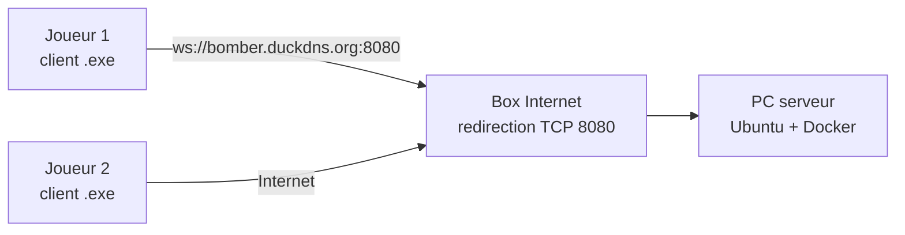

# Héberger le serveur sur un PC transformé en VPS

Ce guide transforme un PC (à la maison) en serveur de jeu accessible depuis Internet, pour jouer
entre amis. Il suppose une installation fraîche d'**Ubuntu Server 24.04 LTS**. Pour un PC qui reste
sous Windows, voir la [dernière section](#variante--pc-sous-windows).



Durée : environ 1 h. Prérequis : le PC, une clé USB (≥ 4 Go), l'accès à l'interface de la box.

## 1. Installer Ubuntu Server

1. Télécharger **Ubuntu Server 24.04 LTS** sur ubuntu.com et l'écrire sur la clé USB (Rufus ou
   balenaEtcher).
2. Démarrer le PC sur la clé et installer avec les options par défaut. Cocher **« Install OpenSSH
   server »**.
3. Brancher le PC à la box **en Ethernet** si possible (plus stable que le Wi-Fi pour du temps réel).
4. Après le redémarrage, relever l'IP locale :

   ```bash
   ip -4 a        # ex. 192.168.1.42
   ```

La suite peut se faire à distance depuis un autre PC du réseau : `ssh <utilisateur>@192.168.1.42`.

## 2. Fixer l'IP locale

Dans l'interface de la box (souvent `http://192.168.1.1`), rubrique **DHCP → bail statique /
réservation d'adresse** : réserver `192.168.1.42` pour ce PC. Sans cela, l'IP peut changer et la
redirection de port (étape 7) ne fonctionnera plus.

## 3. Rester allumé 24h/24

```bash
# Désactiver la mise en veille
sudo systemctl mask sleep.target suspend.target hibernate.target hybrid-sleep.target

# PC portable : continuer à tourner écran rabattu
sudo sed -i 's/^#\?HandleLidSwitch=.*/HandleLidSwitch=ignore/' /etc/systemd/logind.conf
sudo systemctl restart systemd-logind
```

Dans le BIOS, activer **« Restore on AC power loss → Power On »** pour redémarrer automatiquement
après une coupure de courant.

## 4. Installer Docker, Node.js et Git

```bash
sudo apt update && sudo apt upgrade -y

# Docker (démarrage automatique au boot)
curl -fsSL https://get.docker.com | sudo sh
sudo usermod -aG docker "$USER"
sudo systemctl enable docker

# Node.js 24 (nécessaire aux scripts de vérification) + outils
curl -fsSL https://deb.nodesource.com/setup_24.x | sudo -E bash -
sudo apt install -y nodejs git make

exit   # se reconnecter pour que le groupe docker soit pris en compte
```

## 5. Ouvrir le pare-feu

```bash
sudo ufw allow OpenSSH
sudo ufw allow 8080/tcp
sudo ufw enable
```

## 6. Déployer le serveur

```bash
git clone https://github.com/<organisation>/BomberMan-Arena.git
cd BomberMan-Arena
docker compose up -d --build
npm ci
make check-host
```

`make check-host` ([`scripts/check-host.sh`](./scripts/check-host.sh)) vérifie Docker, le
redémarrage automatique, le port, le pare-feu, l'IP locale, la mise en veille, et joue une partie de
test en local. Corriger chaque ligne marquée **✘** avant de continuer, et noter l'**IP publique**
affichée.

> Le conteneur est lancé avec `restart: unless-stopped` : il redémarre seul après un reboot du PC.

## 7. Rediriger le port sur la box

Dans la box, rubrique **NAT/PAT**, **Redirection de ports** ou **Port forwarding** :

| Champ        | Valeur         |
| ------------ | -------------- |
| Protocole    | TCP            |
| Port externe | `8080`         |
| IP interne   | `192.168.1.42` |
| Port interne | `8080`         |

**Vérifier l'absence de CGNAT** : comparer l'IP WAN affichée par la box avec l'IP publique donnée
par `make check-host`.

- Identiques → tout va bien.
- Différentes, ou IP WAN entre `100.64.x.x` et `100.127.x.x` → l'opérateur partage l'IP entre
  plusieurs clients et la redirection est impossible. Demander une IP publique dédiée à l'opérateur
  (souvent gratuit sur demande), ou voir [Sans redirection de port](#sans-redirection-de-port-cgnat).

## 8. Tester depuis l'extérieur

Depuis un PC sur **un autre réseau** (partage de connexion 4G, par exemple), dans le dépôt :

```bash
make smoke URL=ws://<IP-publique>:8080
```

Le test ([`packages/server/scripts/smoke-test.ts`](./packages/server/scripts/smoke-test.ts)) joue
une vraie partie à deux joueurs : santé HTTP, connexion WebSocket, latence, salon privé, démarrage
et déplacement vu par l'autre joueur. S'il se termine par ✅, le serveur est jouable.

> Le test depuis la maison elle-même n'est pas fiable : beaucoup de box ne gèrent pas le
> « NAT loopback ».

## 9. Une adresse stable (DNS dynamique)

L'IP publique d'un particulier peut changer. Avec [DuckDNS](https://www.duckdns.org) (gratuit) :

1. Se connecter, créer un sous-domaine (ex. `bomber-arena`) et copier le token.
2. Sur le PC serveur, mettre à jour l'adresse toutes les 5 minutes :

   ```bash
   (crontab -l 2>/dev/null; echo '*/5 * * * * curl -s "https://www.duckdns.org/update?domains=bomber-arena&token=<TOKEN>" >/dev/null') | crontab -
   ```

3. Les joueurs utilisent désormais `ws://bomber-arena.duckdns.org:8080`.

## 10. Jouer

1. Générer le client Windows (sur un PC de développement) :

   ```bash
   npm run package -w @bomberman/client   # → packages/client/release/*.exe
   ```

2. Envoyer l'exécutable aux joueurs.
3. Dans le jeu : **Paramètres → adresse du serveur** → `ws://bomber-arena.duckdns.org:8080`.
4. Un joueur crée un salon, les autres le rejoignent (salon public ou code d'invitation).

## Maintenance

| Action                | Commande (dans `BomberMan-Arena/`)             |
| --------------------- | ---------------------------------------------- |
| Mettre à jour         | `git pull && docker compose up -d --build`     |
| Voir les logs         | `docker compose logs -f`                       |
| Arrêter / redémarrer  | `docker compose down` / `docker compose up -d` |
| Diagnostiquer         | `make check-host`                              |
| Tester l'image Docker | `make docker-smoke`                            |

## Sécurité

- Seul le port **8080** est redirigé sur la box. **Ne jamais rediriger le port 22 (SSH)** : pour
  administrer le PC à distance, utiliser Tailscale.
- Garder le système à jour : `sudo apt update && sudo apt upgrade -y` (ou activer
  `unattended-upgrades`).
- Les échanges sont en `ws://` (non chiffrés) : suffisant pour jouer entre amis, mais ne rien y
  faire transiter de sensible.

## Sans redirection de port (CGNAT)

- **Tailscale** (le plus simple) : l'installer sur le serveur et sur le PC de chaque joueur, dans le
  même réseau Tailscale. Les joueurs se connectent à `ws://<IP-Tailscale-du-serveur>:8080`. Ni
  redirection ni IP publique nécessaires.
- **Tunnel** (playit.gg, Cloudflare Tunnel) : rend le serveur joignable sans rien installer chez
  les joueurs, au prix d'un peu plus de configuration.

## Variante : PC sous Windows

Possible, mais avec plus de pièges :

1. Installer **Docker Desktop** et activer « Start Docker Desktop when you sign in ».
2. Ouvrir le port dans le pare-feu Windows (PowerShell administrateur) :

   ```powershell
   New-NetFirewallRule -DisplayName Bomberman -Direction Inbound -Protocol TCP -LocalPort 8080 -Action Allow
   ```

3. Désactiver la mise en veille : **Paramètres → Système → Alimentation → Jamais**.
4. Cloner le dépôt et lancer `docker compose up -d --build` (depuis WSL ou PowerShell).

Les étapes 2, 7, 8, 9 et 10 restent identiques. Sous WSL2, `make check-host` signale les réglages
spécifiques (pare-feu Windows, `networkingMode=mirrored`).
