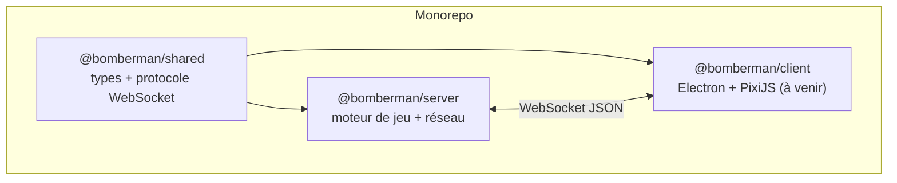

# Architecture

## Vue d'ensemble



`packages/shared` n'a aucune dépendance : c'est le contrat entre le client et le serveur. Il est
compilé (`tsc`) en `.d.ts` + `.js`, puis importé par les deux autres packages via l'alias
`@bomberman/shared` (résolu par les workspaces npm).

Cette séparation stricte répond directement à l'exigence du cahier des charges : _« Séparation
stricte de l'Affichage (Client) et de l'état du jeu (Serveur) »_. Le serveur est seul autoritaire
sur l'état de la partie ; le client ne fera qu'envoyer des intentions (`MOVE`, `PLACE_BOMB`) et
afficher ce que le serveur lui confirme.

## Découpage interne du serveur

```
packages/server/src/
├── engine/          logique de jeu pure, sans réseau ni horloge réelle
│   ├── Round.ts         une manche : déplacements, bombes, explosions, vies, mort subite
│   ├── Grid.ts          génération et accès à la grille
│   ├── drops.ts         tirage des objets (table de probabilités)
│   ├── rng.ts           générateur pseudo-aléatoire déterministe (seedable)
│   └── gameConfig.ts     constantes d'équilibrage
├── lobby/           salons d'attente, indépendants du moteur de jeu
│   ├── Lobby.ts          état d'un salon (joueurs, réglages, statut)
│   ├── LobbyManager.ts   règles de gestion (créer/rejoindre/quitter/démarrer)
│   └── inviteCode.ts     génération de codes d'invitation
├── game/            orchestration d'une partie (plusieurs manches)
│   └── GameSession.ts    enchaîne les Round, calcule le classement final
├── net/             seule couche qui dépend du réseau (ws)
│   ├── GameServer.ts        serveur WebSocket, routage des messages
│   ├── ConnectionRegistry.ts association playerId <-> socket, envoi des messages
│   └── validate.ts          validation stricte des trames entrantes
├── persistence/     accès aux données durables
│   └── dropTableRepository.ts  probabilités de drop des objets, en SQLite
├── errors.ts        erreur métier typée (GameError) traduite en message ERROR
└── index.ts         point d'entrée : câble HTTP + WebSocket + SQLite
```

### Pourquoi ce découpage

- **`engine/` ne dépend de rien d'autre que `shared`.** Un `Round` prend un `now` en paramètre à
  chaque appel plutôt que de lire l'horloge système : il est donc testable de façon déterministe,
  sans timers réels (voir `packages/server/test/round.test.ts`).
- **`lobby/` et `game/` ignorent totalement `ws`.** Ils communiquent uniquement par des callbacks
  (`emit`, `onEnded`) fournis par l'appelant. `GameServer` est le seul point où la logique
  rencontre le réseau.
- **`net/validate.ts`** retype une trame JSON brute en `ClientMessage` ou renvoie `null` : aucune
  donnée non validée n'atteint jamais `LobbyManager` ou `GameSession`.

Cela permet d'appliquer les principes SOLID demandés par le cahier des charges (coef. 3) : chaque
classe a une seule responsabilité, et les dépendances vont dans un seul sens
(`net` → `game`/`lobby` → `engine` → `shared`).

## Boucle de jeu

Une seule boucle (`setInterval` de 50 ms dans `GameServer`) fait avancer **toutes** les parties en
cours : `GameServer.tick()` appelle `GameSession.update(now)` pour chaque session active, qui
délègue à son tour à `Round.update(now)`. Il n'y a pas un timer par bombe ou par joueur — chaque
`Round` compare simplement l'horodatage courant aux échéances qu'il a mémorisées
(`explodeAt`, `nextMoveAt`, `invulnerableUntil`, etc.).

## Choix techniques

| Domaine       | Choix                                 | Justification                                                                      |
| ------------- | ------------------------------------- | ---------------------------------------------------------------------------------- |
| Langage       | TypeScript strict partout             | Détecte les erreurs de protocole à la compilation                                  |
| Communication | WebSocket (`ws`), JSON                | Imposé par le cahier des charges                                                   |
| Aléatoire     | RNG maison seedable (`mulberry32`)    | Génération de grille et de drops reproductible en test                             |
| Persistance   | `node:sqlite` (natif Node ≥ 22)       | Évite une dépendance externe pour la seule donnée à stocker (probabilités de drop) |
| Tests         | Vitest                                | Rapide, API proche de Jest, support natif TS/ESM                                   |
| Qualité       | ESLint (typescript-eslint) + Prettier | Imposé par le cahier des charges                                                   |
