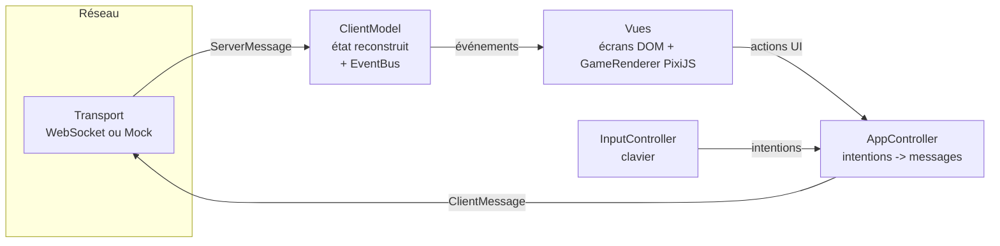

# Client (Electron + PixiJS)

Le client est une application de bureau Electron. Il **n'applique aucune règle de jeu** : il envoie
des intentions au serveur (`MOVE`, `PLACE_BOMB`, `START_GAME`…) et affiche ce que le serveur
confirme. Collisions, explosions et victoires restent côté serveur (anti-triche).

## Architecture : MVC + bus d'événements



| Couche     | Dossier                         | Rôle                                                                        |
| ---------- | ------------------------------- | --------------------------------------------------------------------------- |
| Modèle     | `src/model/`                    | État du salon et de la manche, modifié **uniquement** par les messages      |
| Vue        | `src/view/`                     | Écrans (DOM) et rendu de la partie (PixiJS) ; lit le modèle, ne l'écrit pas |
| Contrôleur | `src/controller/`, `src/input/` | Traduit clics et touches en messages du protocole                           |
| Réseau     | `src/net/`                      | Interface `Transport`, implémentation WebSocket et serveur simulé           |

Le réseau est totalement isolé du rendu : seul `AppController` parle au `Transport`, et seul
`ClientModel.apply()` transforme un message serveur en état. Les vues s'abonnent aux événements du
modèle (`lobby`, `roundStarted`, `roundEvent`, `gameEnded`…) via le bus typé `core/EventBus.ts`.

```
packages/client/
├── electron/          processus principal (fenêtre isolée) + preload (API `quit` uniquement)
├── src/
│   ├── App.ts             composition : modèle, contrôleur, écrans, navigation
│   ├── main.ts            point d'entrée du rendu (`?mock=1` pour le mode hors ligne)
│   ├── core/              EventBus typé
│   ├── model/             ClientModel + fonctions pures de la manche (round.ts)
│   ├── controller/        AppController (intentions -> protocole)
│   ├── input/             KeyMap + InputController (touches maintenues = répétition)
│   ├── net/               Transport, WebSocketTransport, MockTransport, mock/MockServer
│   ├── settings/          préférences (volumes, touches, adresse du serveur) en localStorage
│   ├── audio/             effets sonores synthétisés (WebAudio, aucun fichier audio)
│   ├── assets/            planche de sprites + tuiles, bombes, flammes, icônes (pixel art)
│   └── view/              screens/ (accueil, salons, salle d'attente, partie, résultats),
│                          game/GameRenderer (PixiJS), backdrop/ (décor animé), ui/
└── test/              tests unitaires et d'intégration (Vitest)
```

## Écrans

| Écran           | Contenu (cahier des charges / spécifications fonctionnelles)                                            |
| --------------- | ------------------------------------------------------------------------------------------------------- |
| Accueil         | Pseudo, menu (jouer, créer, rejoindre par code, paramètres, quitter), intro animée, bots en fond        |
| Salons          | Navigateur des salons publics, partie rapide, rejoindre un salon privé par code d'invitation            |
| Salle d'attente | Joueurs, choix de couleur, réglages de l'hôte (joueurs, vies, manches, durée, objets, malus), lancement |
| Partie          | Rendu PixiJS (grille, bombes, flammes, objets, mort subite), HUD (vies, bonus, chrono), pause           |
| Résultats       | Vainqueur, podium, classement détaillé, rappel des manches ; le salon reste actif pour rejouer          |

Paramètres : volume général, volume des effets (SFX), schéma de déplacement (ZQSD ou WASD, flèches
toujours actives), adresse du serveur. Ils sont conservés localement (« paramètre de chaque joueur »).

## Mode hors ligne (mocking de l'UI)

`MockTransport` remplace le WebSocket par un `MockServer` en mémoire qui répond comme le vrai
serveur : salons fictifs, joueurs simulés, manches, bombes, objets, mort subite, classement. Toute
l'interface est donc utilisable sans serveur, et testable :

```bash
npm run dev:client:mock   # http://localhost:5173/?mock=1
```

## Lancer le client

```bash
npm install
npm run build              # shared, server, client
npm run dev:server         # serveur sur ws://localhost:8080
npm run dev:client         # rendu seul dans le navigateur (http://localhost:5173)
npm run start:client       # application Electron (build puis ouverture de la fenêtre)
npm run package -w @bomberman/client   # exécutable Windows portable dans packages/client/release
```

Le client se connecte à `ws://localhost:8080` par défaut ; l'adresse se change dans les
paramètres du jeu (ou `?server=ws://hôte:8080` en développement).

## Sécurité

- Fenêtre Electron avec `contextIsolation`, `sandbox` et sans `nodeIntegration` ; le preload
  n'expose que `quit()`.
- Politique de sécurité (CSP) stricte dans `index.html` : pas d'`eval` (PixiJS est importé via
  `pixi.js/unsafe-eval`, la variante sans `new Function`), connexions limitées à `ws:`/`wss:`.
- Les pseudos et noms de salon venant d'autres joueurs sont échappés avant tout affichage HTML.

## Tests

`npm run test -w @bomberman/client` couvre : bus d'événements, modèle et application de chaque
événement du protocole, entrées clavier (répétition, bombe, pause), préférences, transport
WebSocket (trames invalides, liaison fermée), contrôleur (messages émis) et parcours complet
contre le serveur simulé. Les couches purement graphiques (PixiJS, DOM, WebAudio) sont exclues de la
couverture ; elles sont vérifiées visuellement via le mode hors ligne.

## Limite connue : « prêt »

La spécification fonctionnelle indique que la partie commence quand chaque joueur est prêt. Le
protocole actuel n'a pas de message `READY` : c'est l'hôte qui lance la partie (`START_GAME`). Le
client suit le protocole existant ; ajouter l'état « prêt » demande une évolution du serveur et du
contrat `shared`.
