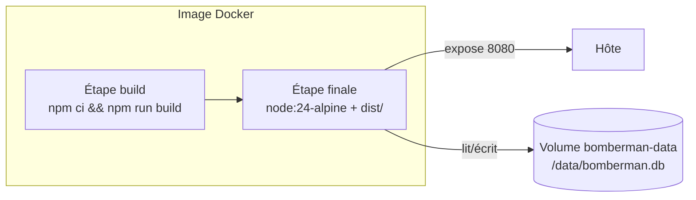

# Déploiement

## Variables d'environnement (serveur)

| Variable  | Défaut                | Rôle                                                         |
| --------- | --------------------- | ------------------------------------------------------------ |
| `PORT`    | `8080`                | Port d'écoute HTTP + WebSocket                               |
| `DB_PATH` | `./data/bomberman.db` | Fichier SQLite des probabilités de drop (`:memory:` en test) |

## En local (sans Docker)

```bash
npm install
npm run build
PORT=8080 npm run dev:server     # ou : node packages/server/dist/index.js
curl localhost:8080/health       # -> { "status": "ok" }
```

Sous PowerShell : `$env:PORT=8080; npm run dev:server`.

## Avec Docker

Le `Dockerfile` à la racine construit une image en deux étapes (build TypeScript puis image de
production allégée, `node:24-alpine`) :

```bash
docker compose up --build
```

`docker-compose.yml` publie le port `8080` et monte un volume nommé (`bomberman-data`) sur
`/data`, pour que la base SQLite des probabilités de drop survive aux redémarrages du conteneur.



Le client (Electron) sera livré sous forme d'**exécutable natif non dockerisé**, conformément au
cahier des charges — ce point reste à implémenter.

## CI/CD

Le workflow [`ci.yml`](../.github/workflows/ci.yml) s'exécute à chaque `push` et `pull_request` :

1. **Build** : compile `shared` puis `server`.
2. **Lint** : ESLint (règles TypeScript) sur tout le dépôt.
3. **Format** : vérifie que Prettier ne trouve rien à reformater.
4. **Tests** : exécute la suite Vitest avec couverture.

L'échec de n'importe quelle étape bloque le pipeline, comme l'exige le cahier des charges (§4.2).
