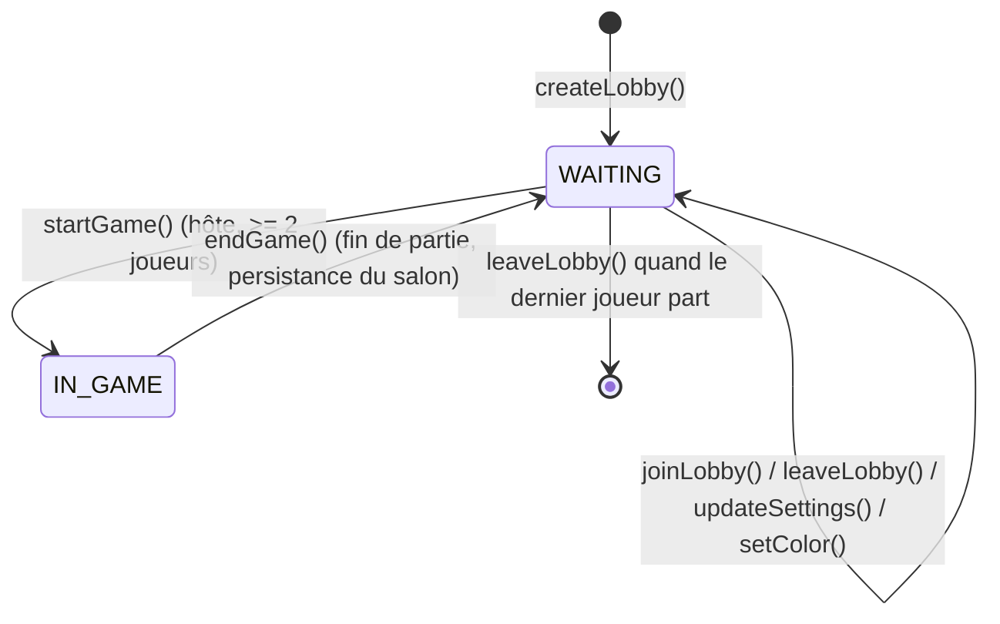
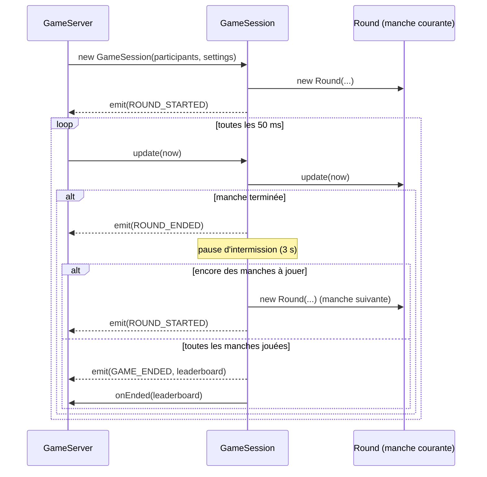

# Lobbies et parties

## Le salon (`Lobby` / `LobbyManager`)

Un salon (`Lobby`) a un statut `WAITING` ou `IN_GAME`, une visibilité `PUBLIC` ou `PRIVATE`, une
liste de joueurs et des réglages. Le `LobbyManager` est le registre unique de tous les salons du
serveur ; il ne connaît rien du réseau, seulement les règles de gestion.

### Règles appliquées

| Action           | Qui peut la faire | Conditions                                            |
| ---------------- | ----------------- | ----------------------------------------------------- |
| `createLobby`    | n'importe qui     | ne doit pas déjà être dans un salon                   |
| `joinLobby`      | n'importe qui     | salon trouvé (id ou code), `WAITING`, non plein       |
| `updateSettings` | l'hôte            | salon `WAITING` ; valeurs bornées (`SETTINGS_LIMITS`) |
| `setColor`       | tout membre       | couleur non déjà prise dans le salon                  |
| `startGame`      | l'hôte            | salon `WAITING`, ≥ `MIN_PLAYERS_TO_START` (2) joueurs |
| `leaveLobby`     | tout membre       | — (idempotent ; promeut un nouvel hôte si besoin)     |

Quand l'hôte quitte, le joueur suivant dans l'ordre d'arrivée est automatiquement promu (`isHost`
passe à `true`). Quand le dernier joueur quitte, le salon est supprimé du registre.

### Persistance du lobby entre deux parties

À la fin d'une partie, `GameSession` appelle `onEnded()`, qui déclenche
`LobbyManager.endGame(lobbyId)` : le statut repasse à `WAITING` **sans vider la liste des
joueurs**. Les joueurs restent dans le même salon et peuvent relancer une partie immédiatement —
c'est l'exigence _« entre chaque partie, le lobby reste actif »_.

## La partie (`GameSession`)

Une `GameSession` est créée au moment où l'hôte lance la partie (`START_GAME`). Elle encapsule
l'enchaînement des manches et ignore totalement le réseau (elle communique via les callbacks
`emit` et `onEnded` fournis par `GameServer`).

### Statistiques et classement

Chaque joueur accumule, sur toute la partie : nombre de victoires (manches remportées), kills,
vies perdues, bombes posées, objets ramassés. À la fin, `GameSession.finish()` trie les joueurs par
victoires puis par kills et construit le `LeaderboardEntry[]` envoyé dans `GAME_ENDED` — c'est le
tableau des scores de fin de partie demandé par la spécification fonctionnelle.

### Joueur qui quitte en cours de partie

`GameSession.removePlayer(playerId, now)` marque le joueur comme `left = true` : il est éliminé de
la manche en cours (s'il y en a une) et n'est plus inclus dans les manches suivantes, mais il
conserve sa ligne dans le classement final (`left: true`).

## Table récapitulative des réglages (`LobbySettings`)

| Réglage            | Borne    | Rôle                                           |
| ------------------ | -------- | ---------------------------------------------- |
| `maxPlayers`       | 2 à 4    | Capacité du salon                              |
| `lives`            | 1 à 5    | Vies de chaque joueur en début de manche       |
| `timeLimitSeconds` | 30 à 600 | Durée avant le déclenchement de la mort subite |
| `rounds`           | 1 à 9    | Nombre de manches de la partie                 |
| `itemsEnabled`     | booléen  | Active l'apparition d'objets                   |
| `malusEnabled`     | booléen  | Autorise les malus parmi les objets tirés      |
