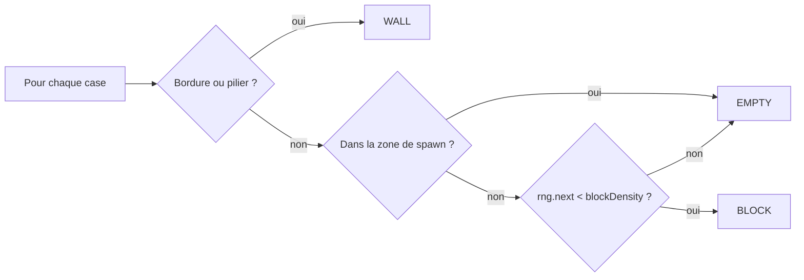
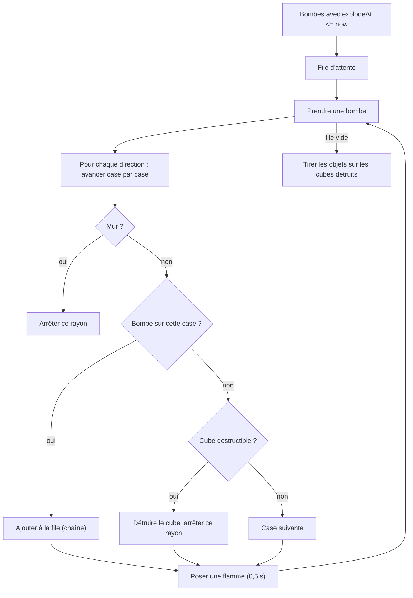

# Moteur de jeu (`engine/`)

Le moteur est entièrement **autoritaire côté serveur** (exigence anti-triche du cahier des
charges) et **déterministe** : aucune classe de `engine/` ne lit `Date.now()` ou `Math.random()`
directement. L'horloge (`now`) est passée en paramètre à chaque appel, et l'aléatoire passe par un
`Rng` injecté — ce qui permet de rejouer exactement la même partie en test avec une graine fixe.

## Génération de la grille (`grid.ts`)

- Dimensions fixes : 15 × 13 cases.
- Bordure et piliers (`x % 2 === 0 && y % 2 === 0`) → murs indestructibles (`WALL`).
- Les 4 coins intérieurs sont les points d'apparition (`spawnPoints`).
- Toute case à distance de Manhattan ≤ 2 d'un spawn est **protégée** : elle ne peut jamais recevoir
  de cube destructible (`isInSpawnSafeZone`). Ça garantit l'exigence _« l'algorithme garantit que
  les cubes destructibles ne bloquent pas les zones d'apparition »_.
- Les autres cases libres reçoivent un cube destructible (`BLOCK`) avec une probabilité
  `blockDensity` (70 % par défaut, `gameConfig.ts`).

## Cycle de vie d'une manche (`Round.ts`)

1. **Construction** : génère la grille, mélange les 4 points de spawn, place les participants,
   leur donne `settings.lives` vies et une **invulnérabilité de 3 s**.
2. **`move(playerId, direction, now)`** : refuse si la manche est finie, le joueur mort, le
   cooldown (`nextMoveAt`) non écoulé, ou la case cible non `EMPTY` / occupée par une bombe.
   Sinon déplace, émet `POSITION_UPDATED`, puis vérifie le ramassage d'objet.
3. **`placeBomb(playerId, now)`** : refuse si la limite de bombes actives du joueur est atteinte.
   Sinon crée une bombe avec `explodeAt = now + bombFuseMs` (2 s par défaut).
4. **`update(now)`**, appelé toutes les 50 ms par la boucle de jeu serveur :
   - fait exploser les bombes dont `explodeAt <= now` (en cascade, cf. ci-dessous) ;
   - expire les flammes (0,5 s) et inflige des dégâts aux joueurs qui se trouvent dessus ;
   - fait avancer la mort subite si le temps limite est dépassé ;
   - termine la manche si ≤ 1 joueur reste en vie.

### Explosions en chaîne

Une bombe déclenchée par une autre explosion (case contenant une bombe traversée par un rayon) est
immédiatement ajoutée à la file : toutes les bombes d'une même réaction en chaîne explosent lors
du même appel à `update()`.

## Vies, respawn, invulnérabilité

- Un joueur touché par une flamme perd une vie (`hit()`), sauf s'il est encore invulnérable
  (`now < invulnerableUntil`).
- S'il lui reste des vies, il **réapparaît à son point de spawn d'origine** avec une nouvelle
  fenêtre d'invulnérabilité de 3 s — _« protection au point d'apparition après une résurrection »_.
- À 0 vie, il est éliminé (`PLAYER_ELIMINATED`), et si un adversaire est à l'origine des flammes,
  celui-ci gagne un kill dans ses statistiques.

## Objets (bonus / malus)

Tirés par `drops.ts` à partir d'une `DropTable` (probabilité globale + poids par type), chargée
depuis la base SQLite (voir [deploiement.md](./deploiement.md)).

| Catégorie | Objet           | Effet                                                             |
| --------- | --------------- | ----------------------------------------------------------------- |
| Bonus     | `RANGE_UP`      | +1 case de portée d'explosion (plafond 8)                         |
| Bonus     | `BOMB_UP`       | +1 bombe posable simultanément (plafond 6)                        |
| Bonus     | `SPEED_UP`      | +25 % de vitesse de déplacement par niveau (plafond 5)            |
| Malus     | `SURPRISE_BOMB` | Pose immédiatement une bombe sur le joueur, hors limite de bombes |
| Malus     | `SLOW`          | Multiplie le délai de déplacement par 2,5 pendant 5 s             |

Les malus ne sont tirés que si `settings.malusEnabled` est actif ; aucun objet n'apparaît si
`settings.itemsEnabled` est désactivé.

## Mort subite (rétrécissement de la zone)

Quand `now` dépasse `settings.timeLimitSeconds`, la manche passe en mort subite
(`SUDDEN_DEATH_STARTED`). Les cases se transforment en murs selon un ordre **spirale** (bord
extérieur → centre, `spiralOrder()`), une case toutes les 250 ms. Une case fermée :

- détruit toute bombe ou objet qui s'y trouvait ;
- élimine instantanément tout joueur encore présent (aucune invulnérabilité ne protège ici).

## Fin de manche

`checkEnd()` est appelé à chaque `update()` : dès qu'il ne reste **au plus un joueur vivant**, la
manche se termine (`finished = true`, `winnerId`). C'est `GameSession` (voir
[lobbies-et-parties.md](./lobbies-et-parties.md)) qui décide d'enchaîner sur la manche suivante ou
de clore la partie.
