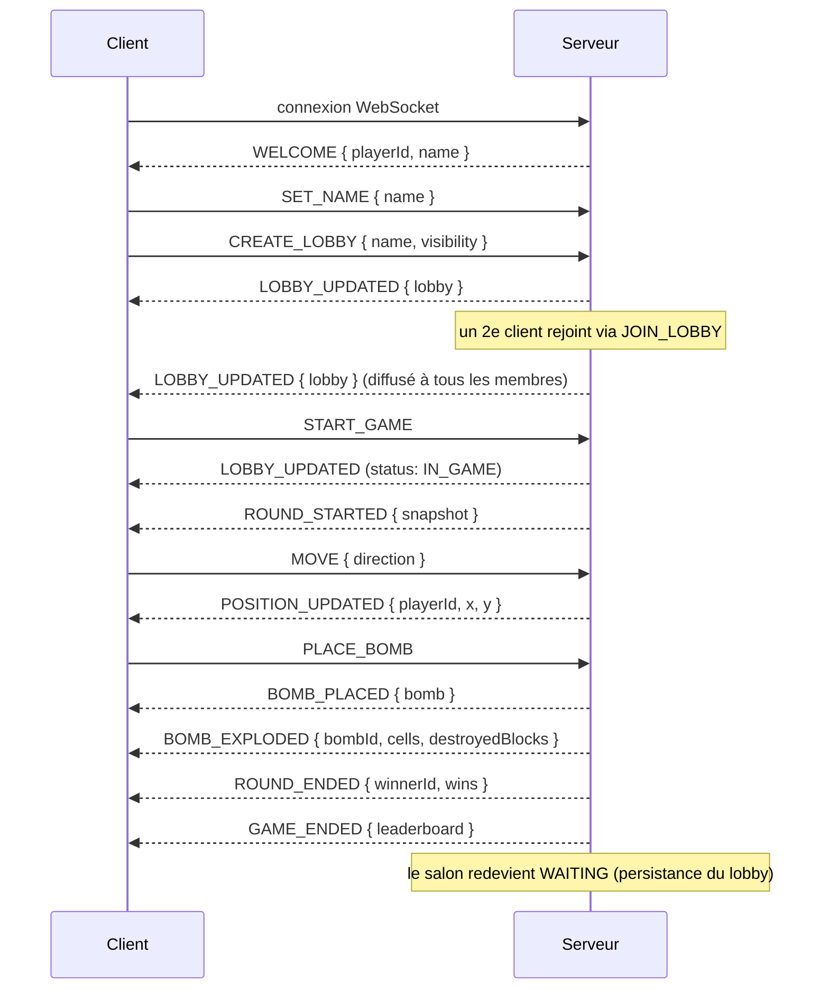

# Protocole WebSocket

Toutes les trames sont du **JSON**, sous la forme d'une enveloppe unique :

```json
{ "type": "NOM_DU_MESSAGE", "payload": {/* ... */} }
```

La définition canonique (source de vérité) se trouve dans
[`packages/shared/src/protocol.ts`](../packages/shared/src/protocol.ts) : chaque message y est un
type TypeScript, et l'union `ClientMessage` / `ServerMessage` garantit que client et serveur
partagent exactement le même contrat. Ce document en est la version lisible.

## Cycle de vie d'une connexion



## Messages Client → Serveur

| Type              | Payload                                                | Effet                                                    |
| ----------------- | ------------------------------------------------------ | -------------------------------------------------------- |
| `SET_NAME`        | `{ name: string }`                                     | Définit le pseudo (≤ 20 caractères)                      |
| `LIST_LOBBIES`    | `{}`                                                   | Demande la liste des salons publics en attente           |
| `CREATE_LOBBY`    | `{ name, visibility: 'PUBLIC'\|'PRIVATE', settings? }` | Crée un salon, l'émetteur en devient l'hôte              |
| `JOIN_LOBBY`      | `{ lobbyId? , inviteCode? }`                           | Rejoint un salon public (par id) ou privé (par code)     |
| `LEAVE_LOBBY`     | `{}`                                                   | Quitte le salon courant (idempotent)                     |
| `UPDATE_SETTINGS` | `{ settings: Partial<LobbySettings> }`                 | Modifie les réglages (hôte uniquement, salon en attente) |
| `SET_COLOR`       | `{ color: PlayerColor }`                               | Choisit une couleur non prise par un autre membre        |
| `START_GAME`      | `{}`                                                   | Lance la partie (hôte uniquement, ≥ 2 joueurs)           |
| `MOVE`            | `{ direction: 'UP'\|'DOWN'\|'LEFT'\|'RIGHT' }`         | Demande un déplacement d'une case                        |
| `PLACE_BOMB`      | `{}`                                                   | Demande la pose d'une bombe sur la case courante         |

Toute trame malformée (champ manquant, type incorrect, valeur hors énumération) est rejetée par
`net/validate.ts` **avant** d'atteindre la logique métier, et répond `ERROR` (`INVALID_MESSAGE`).

## Messages Serveur → Client

### Connexion et salon

| Type            | Payload                                | Quand                                                     |
| --------------- | -------------------------------------- | --------------------------------------------------------- |
| `WELCOME`       | `{ playerId, name }`                   | Juste après la connexion                                  |
| `LOBBY_LIST`    | `{ lobbies: LobbySummary[] }`          | Réponse à `LIST_LOBBIES`                                  |
| `LOBBY_UPDATED` | `{ lobby: LobbyInfo }`                 | À chaque changement du salon (diffusé à tous ses membres) |
| `LOBBY_LEFT`    | `{}`                                   | Confirmation de départ du salon                           |
| `ERROR`         | `{ code: ErrorCode, message: string }` | Message rejeté ou règle métier violée                     |

### Événements de partie (`GameEventMessage`)

| Type                   | Payload                              | Déclencheur                                        |
| ---------------------- | ------------------------------------ | -------------------------------------------------- |
| `ROUND_STARTED`        | `{ snapshot: RoundSnapshot }`        | Début d'une manche (grille, joueurs, état complet) |
| `POSITION_UPDATED`     | `{ playerId, x, y }`                 | Déplacement validé par le serveur                  |
| `PLAYER_UPDATED`       | `{ player: PlayerState }`            | Changement de vies/bonus/statuts d'un joueur       |
| `PLAYER_ELIMINATED`    | `{ playerId, killerId }`             | Un joueur perd sa dernière vie                     |
| `BOMB_PLACED`          | `{ bomb: BombState }`                | Pose d'une bombe                                   |
| `BOMB_EXPLODED`        | `{ bombId, cells, destroyedBlocks }` | Explosion (après la mèche, ou en chaîne)           |
| `ITEM_SPAWNED`         | `{ item: ItemState }`                | Un objet apparaît après destruction d'un cube      |
| `ITEM_DESTROYED`       | `{ itemId }`                         | Un objet est détruit par une explosion             |
| `ITEM_PICKED`          | `{ itemId, playerId, itemType }`     | Un joueur ramasse un objet                         |
| `SUDDEN_DEATH_STARTED` | `{}`                                 | Le temps limite est atteint                        |
| `ARENA_SHRUNK`         | `{ cells }`                          | Des cases deviennent des murs (mort subite)        |
| `ROUND_ENDED`          | `{ roundNumber, winnerId, wins }`    | Fin d'une manche                                   |
| `GAME_ENDED`           | `{ leaderboard }`                    | Fin de la partie (toutes les manches jouées)       |

### Codes d'erreur (`ErrorCode`)

`INVALID_MESSAGE` · `LOBBY_NOT_FOUND` · `LOBBY_FULL` · `INVALID_INVITE_CODE` ·
`GAME_IN_PROGRESS` · `ALREADY_IN_LOBBY` · `NOT_IN_LOBBY` · `NOT_HOST` · `INVALID_SETTINGS` ·
`COLOR_TAKEN` · `NOT_ENOUGH_PLAYERS` · `NOT_IN_GAME`

## Exemple vérifié par les tests

L'exigence du cahier des charges (§4.3) — _« envoi d'une commande MOVE et vérification de la
réponse POSITION_UPDATED »_ — est couverte par
[`packages/server/test/integration/websocket.test.ts`](../packages/server/test/integration/websocket.test.ts),
qui démarre un vrai serveur HTTP+WebSocket et simule deux clients réels (`ws`) :

```json
// Client -> Serveur
{ "type": "MOVE", "payload": { "direction": "RIGHT" } }

// Serveur -> Client (si le déplacement est valide)
{ "type": "POSITION_UPDATED", "payload": { "playerId": "…", "x": 2, "y": 1 } }
```
